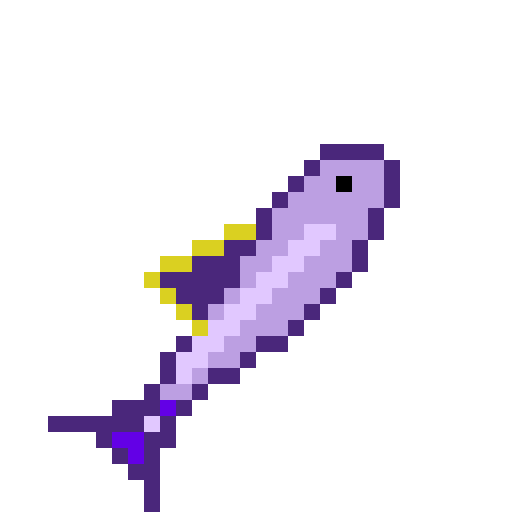
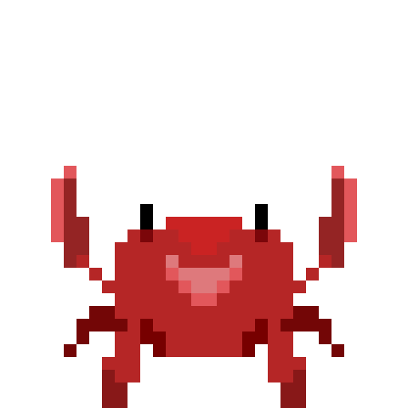
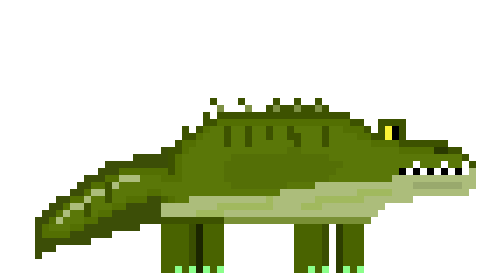
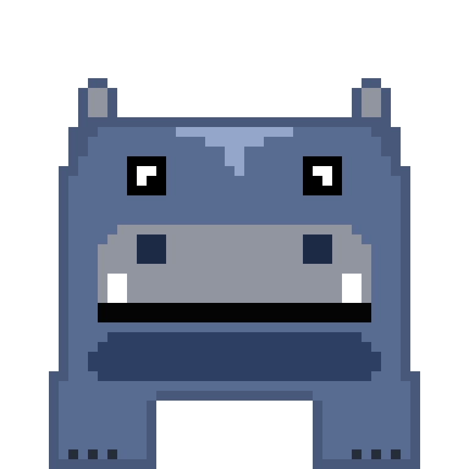

# Karkinolution

Karkinolution is a C++ creature simulator that explores the world from an individual's perspective: how a creature is
doing, what it may do next, and how it behaves within its environment. See the [project vision](docs/VISION.md).

The simulation runs on a server. A client connects to the server to request and display authoritative world state; the
client does not modify simulation models directly.

## Creatures

Currently implemented species:

- Fish 🐟

  

- Crab 🦀

  

- Crocodile 🐊

  

- Hippopotamus 🦛

  

Other simulated entities include corpses:


Each species has its own traits, behaviors, and ecological interactions.

## Getting started

The project uses CMake presets, Ninja, Conan, and the C++23 toolchain described in
[`HOW_TO_RUN.md`](HOW_TO_RUN.md). The shortest first build is:

```bash
conan install . --build=missing -s build_type=Debug
cmake --preset debug
cmake --build --preset debug --parallel 2
ctest --preset debug
```

For the complete setup, server, client, application, sanitizer, Docker, and CI instructions, read
[`HOW_TO_RUN.md`](HOW_TO_RUN.md).

To run the standalone server after building:

```bash
./build/karkinolution_server
```

The default server port is `9000`. The starter client and the graphical application have their own build and run
instructions in the setup guide.

## Project structure

```text
shared/          reusable KShared types, algorithms, math, and binary primitives
karkinolution/   simulation models, domain APIs, protocol frames, server, and client networking
opsiamethystos/  graphics and UI primitives
app/             application and view composition
tests/           unit, invariant, protocol, networking, and integration tests
docs/            architecture, rules, commands, and project documentation
```

The main architectural boundaries are:

- `shared/` provides reusable infrastructure without depending on simulation or protocol models.
- `karkinolution/api/` is the domain boundary used by external consumers and networking adapters.
- `karkinolution/networking/` transports typed system and world requests through binary frames.
- `opsiamethystos/` and `app/` depend on client-facing APIs and presentation state, not the other way around.

## Networking at a glance

A normal request follows this path:

```text
client interpreter
    -> request frame and scope
    -> client transport
    -> server connection and session manager
    -> frame processor and domain API
    -> authoritative world
    -> response frame
    -> client response correlation and deserializer
```

The transport has two scopes: `SERVER` for system operations such as world acquisition and `WORLD` for operations on
an acquired world. Responses are correlated with request IDs. Networking changes must be validated with ThreadSanitizer
because the client and server use asynchronous I/O and synchronized shared state.

## Documentation

- [`docs/ARCHITECTURE.md`](docs/ARCHITECTURE.md): module responsibilities and the complete request/response flow
- [`HOW_TO_RUN.md`](HOW_TO_RUN.md): prerequisites, setup, build, run, tests, sanitizers, Docker, and CI
- [`docs/CLIENT.md`](docs/CLIENT.md): public C++ client API and lifecycle
- [`PROTOCOL.md`](PROTOCOL.md): protocol overview
- [`shared/binary/BINARY_CONVENTIONS.md`](shared/binary/BINARY_CONVENTIONS.md): SRI/DSI, layouts, offsets, and frame buffering
- [`karkinolution/networking/frame/README.md`](karkinolution/networking/frame/README.md): frame architecture and request flow
- [`karkinolution/networking/frame/FRAME_CONVENTIONS.md`](karkinolution/networking/frame/FRAME_CONVENTIONS.md): frame-specific protocol and layout rules
- [`docs/commands.md`](docs/commands.md): development commands and CMake presets
- [`CLI.md`](CLI.md): the `karkinolution` command-line tool
- [`docs/rules.md`](docs/rules.md): architectural and coding rules
- [`CONTRIBUTING.md`](CONTRIBUTING.md): contribution and commit conventions
- [`docs/anniversary/ANNIVERSARY.md`](docs/anniversary/ANNIVERSARY.md): project anniversary notes

## Contributing

Read [`CONTRIBUTING.md`](CONTRIBUTING.md) and the relevant architecture and testing guides before changing the
project. Tests should protect meaningful invariants or exercise real integration flows. See
[`tests/HOW_TO_CREATE_TESTS.md`](tests/HOW_TO_CREATE_TESTS.md) for the testing conventions.
