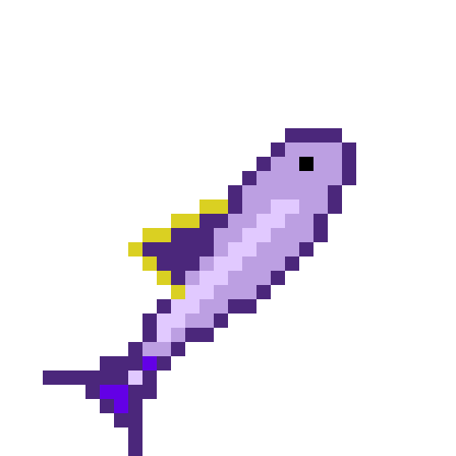
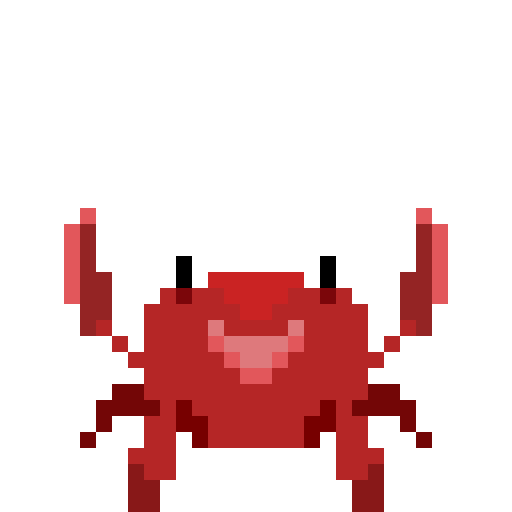
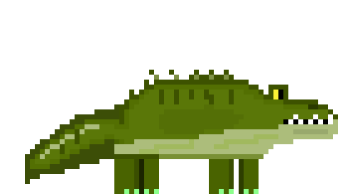
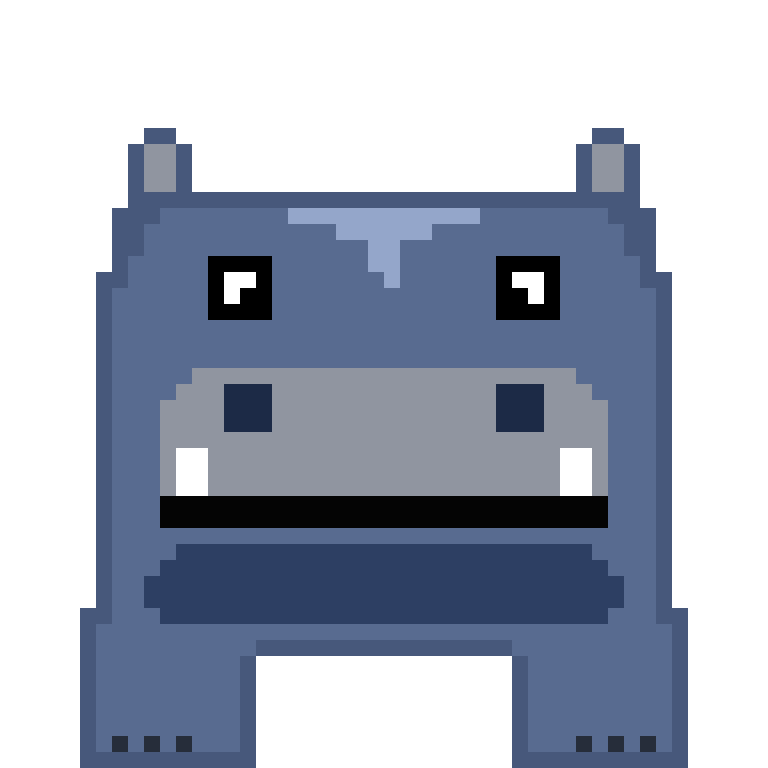
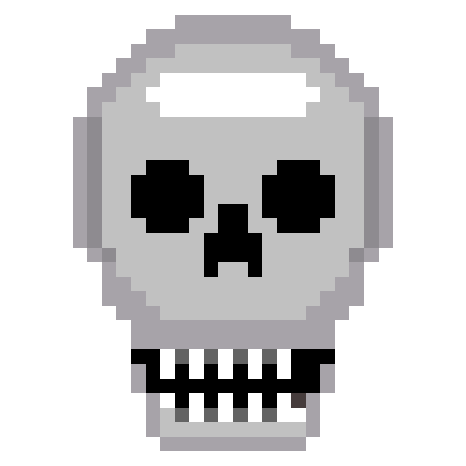

# Karkinolution

A creature simulator written in C++ that looks at the world from the individual's perspective: how is each creature
doing, what will it do next, how will it behave. See the [vision](docs/VISION.md).

The simulation runs as a server, and a client connects to it to display the world.

## Anniversary

See [ANNIVERSARY](docs/anniversary/ANNIVERSARY.md)

## Creatures
Currently implemented species:
* Fish 🐟

* Crab 🦀

* Crocodile 🐊

* Hippopotamus 🦛

### Others

* Corpse 💀

Each species has different traits, behaviors, and ecological interactions.

## Getting started

Build and run instructions are in [`HOW_TO_RUN.md`](HOW_TO_RUN.md).

## Documentation

* [`HOW_TO_RUN.md`](HOW_TO_RUN.md): first build and run
* [`docs/SDK.md`](docs/SDK.md): use the C++ SDK
* [`docs/commands.md`](docs/commands.md): every build preset, Docker and CI command
* [`CLI.md`](CLI.md): the `karkinolution` command line tool
* [`docs/rules.md`](docs/rules.md): structural rules of the code
* [`CONTRIBUTING.md`](CONTRIBUTING.md): commit message format
